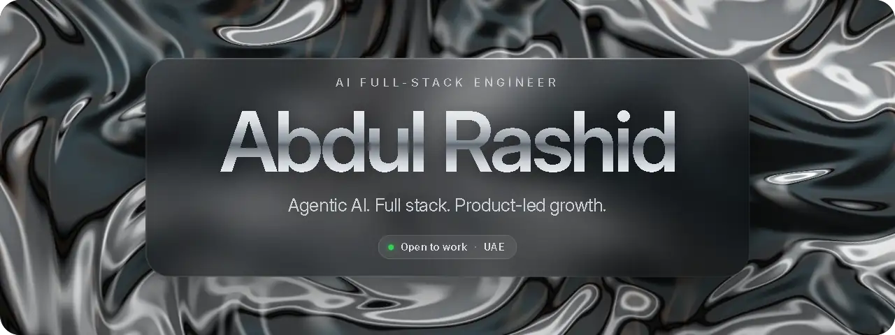

 
 

&nbsp;&nbsp;

 

<b>Selected pull requests</b>

 

- [Require a press-and-hold to send the SMS custom message](https://github.com/hushh-labs/hushh-research/pull/5478)
- [Destroy native map on teardown so the map re-renders on re-open](https://github.com/hushh-labs/hushh-research/pull/5090)
- [Name the counterparty in feed events before falling back to "Someone"](https://github.com/hushh-labs/hushh-research/pull/5107)
- [Structural type validation inside `normalizeConsentResponse`](https://github.com/hushh-labs/hushh-research/pull/3088)
- [Geo-anchor location in JobPosting schema for search visibility](https://github.com/hushh-labs/hushh-search-console/pull/629)

[All merged pull requests](https://github.com/search?q=author%3Aabdulbeast4-creator+is%3Apr+is%3Amerged&type=pullrequests)

 

 
 

<picture>
  <source media="(prefers-color-scheme: dark)" srcset="https://raw.githubusercontent.com/abdulbeast4-creator/abdulbeast4-creator/output/github-contribution-grid-snake-dark.svg" />
  
</picture>

<!-- Visuals are generated from design/. Edit design/src/profile.js, then run `npm run build` in design/. -->
